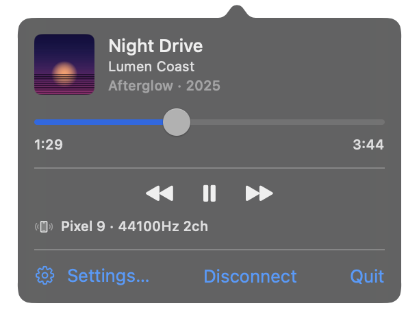

<p align="center">
  
</p>

<p align="center">
  <b>Play the music on your Android phone through your Mac's speakers.</b><br>
  A tiny menu bar app for <a href="https://play.google.com/store/apps/details?id=me.arsentsn.noirplayer">Noir Player</a>. Free and open source.
</p>

<p align="center">
  <a href="https://github.com/arsentsn/noir-receiver/releases/latest"></a>
  
  
  <a href="LICENSE"></a>
</p>

<p align="center">
  
</p>

<p align="center">
  
</p>

- **Lossless.** CD-quality audio over your Wi-Fi.
- **In your menu bar.** Song, artist, cover and a scrubber, with the icon moving to the music.
- **Your Mac's controls work.** Play, pause and skip from the menu bar, the media keys or
  Control Center, and the phone follows.
- **Nothing to configure.** Your phone finds your Mac by itself.
- **Only your phones.** A new phone has to be allowed once, so nobody else on your Wi-Fi can play
  through your Mac.

## Install

**The easy way.** Open Terminal (press ⌘ Space, type *Terminal*, press Return), paste this line,
press Return:

```sh
curl -fsSL https://raw.githubusercontent.com/arsentsn/noir-receiver/main/install.sh | sh
```

That's it: Noir Receiver is in your Applications folder and running. Run the same line again
to update. ([Here's what the script does.](install.sh))

**Or download it.** Get
[Noir-Receiver.zip](https://github.com/arsentsn/noir-receiver/releases/latest/download/Noir-Receiver.zip),
open it, and drag **Noir Receiver** into Applications. The first time you open it, macOS says
*"Apple could not verify 'Noir Receiver' is free of malware"* (older macOS: *"cannot be opened
because the developer cannot be verified"*). That's because the app isn't signed with a paid Apple
developer account. Click **Done**, open **System Settings → Privacy & Security**, scroll down and
click **Open Anyway**. You only do this once.

## Set up

1. When your Mac asks whether Noir Receiver may find devices on your local network, click **Allow**.
2. In Noir Player on your phone, turn on **Settings → Stream to Noir Receiver**.
3. In the player, open the output picker and choose your Mac. The first time, click **Allow** on
   your Mac.

Want it running all the time? Open **Settings…** from the popover and turn on **Start at login**.

## Good to know

- Your phone and your Mac need to be on the **same Wi-Fi**.
- Everything stays on your network. No accounts, no cloud, no tracking.

**Uninstall:** click **Quit** in the popover, then drag Noir Receiver from Applications to the Trash.

## For developers

Building from source, how it works, and the wire protocol: [DEVELOPING.md](DEVELOPING.md).
Issues and pull requests are welcome.

[MIT](LICENSE) © arsentsn
